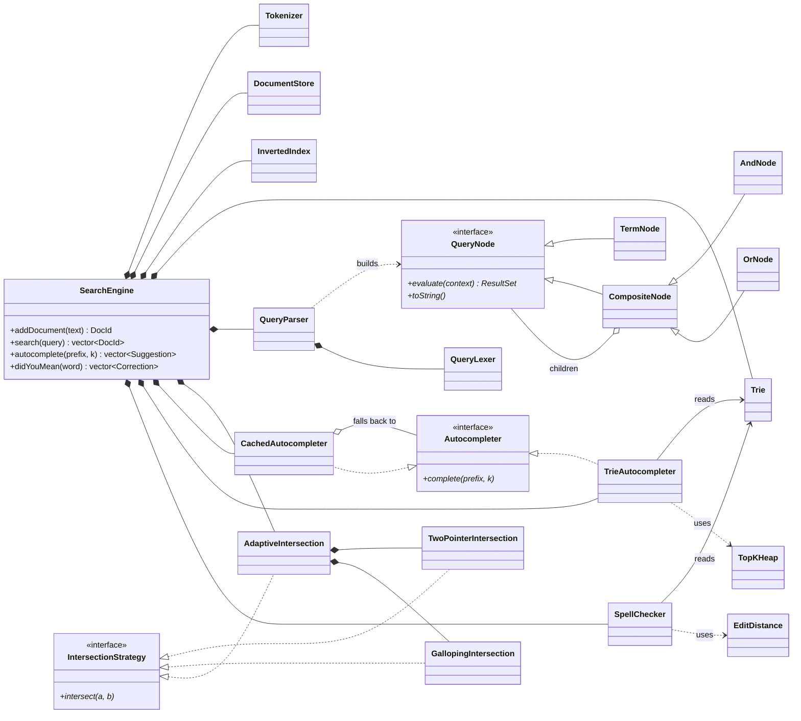

# seek

[](https://github.com/gusfring3369/seek/actions/workflows/ci.yml)


An in-memory full-text search engine in modern C++20 with three query paths:

- **Boolean search** over an **inverted index**. Supports `AND`, `OR` and parentheses, and picks between a two-pointer merge and **galloping search** for each intersection.
- **Top-k autocomplete** from a **prefix trie** and a **bounded min-heap**. A **top-k cache** answers short prefixes and is updated on every insert.
- **Typo-tolerant "did you mean?"** search. It runs **Levenshtein dynamic programming** row by row during a trie DFS and **prunes** subtrees that can't match.

```text
seek> distributed AND (storage OR database)
(distributed AND (storage OR database)) -> 2 document(s) (12.0 µs)
  [2] High performance distributed database built on a B+ tree storage engine
  [5] Distributed key value storage engine with a skip list memtable and write ahead log
seek> consensus algoritms
(consensus AND algoritms) -> 0 document(s) (1.2 µs)
  'algoritms' is not indexed. Did you mean 'algorithms'?
seek> :complete d
5 completion(s) for 'd' (0.4 µs)
  distributed              freq 5
  database                 freq 4
  ...
```

## Highlights

Measured on a 370,105-word English dictionary ([benchmarks](#benchmarks)):

| | Result |
|---|---|
| Autocomplete, 1–3 character prefixes | **p99 ≤ 2.2 µs** with the top-k cache, compared with up to 4 ms for a plain trie walk |
| Autocomplete, any prefix length | **p99 ≤ 0.22 ms** |
| Fuzzy search, 1 edit | **0.23 ms mean, 215× faster** than running the DP against every word. Computes **0.06%** of the DP cells. |
| Fuzzy search, 2 edits | 2.5 ms mean, 20× faster. Visits **1.7%** of trie nodes. |
| `AND` on posting lists of 91 and 1M ids | **7 µs** with galloping, compared with 678 µs for the two-pointer merge |
| Correctness | 62 tests, including randomized property tests against brute-force reference implementations. Runs clean under ASan/UBSan. Builds with `-Werror` on GCC and Clang. |

## Quick start

Requirements: a C++20 compiler (GCC ≥ 13 or Clang ≥ 17 for `<format>`) and CMake ≥ 3.20. GoogleTest is used if it is installed and downloaded automatically otherwise.

```bash
cmake -S . -B build
cmake --build build -j
./build/seek data/sample_corpus.txt          # interactive shell, one document per line
ctest --test-dir build --output-on-failure   # unit + property + CLI tests
```

Shell commands:

| Input | Action |
|---|---|
| `distributed AND (storage OR database)` | Boolean search. `AND` binds tighter than `OR`, and adjacent words are ANDed. |
| `:complete <prefix>` / `:c` | Top-5 completions by corpus frequency |
| `:fix <word>` / `:f` | "Did you mean" suggestions within 2 edits |
| `:stats`, `:help`, `:quit` | — |

The library can also be used directly:

```cpp
#include "seek/engine/search_engine.hpp"

seek::SearchEngine engine;
engine.addDocument("Distributed key value storage engine with a skip list");
engine.addDocument("High performance distributed database with a B+ tree index");

std::vector<seek::DocId> hits = engine.search("distributed AND (storage OR database)");  // {0, 1}
auto completions = engine.autocomplete("dat", 5);  // {"database", weight 1}
auto corrections = engine.didYouMean("databse");    // {"database", 1 edit, weight 1}
```

## Architecture

The code is split into one folder per subsystem and one class per file. Each subsystem only
depends on the ones above it in this list:

| Folder | Classes | What it does |
|---|---|---|
| `common/` | `DocId`, `PostingList`, `Weight`, `StringHash` | Shared type names |
| `text/` | `Tokenizer` | Text → lowercase terms. Documents and queries both use it, so they always agree on what a word is. |
| `trie/` | `Trie`, `TrieNode` | Prefix tree mapping each word to a weight (its frequency). Nodes are read-only outside `Trie`. |
| `autocomplete/` | `Autocompleter` (interface), `TrieAutocompleter`, `CachedAutocompleter`, `TopKHeap`, `Suggestion` | Top-k completions for a prefix |
| `spellcheck/` | `SpellChecker`, `EditDistance`, `Correction` | "Did you mean?" within a few typos |
| `index/` | `InvertedIndex`, `IntersectionStrategy` (interface), `TwoPointerIntersection`, `GallopingIntersection`, `AdaptiveIntersection`, `unionOf` | Term → documents, and the set operations behind AND / OR |
| `query/` | `QueryLexer`, `QueryParser`, `QueryNode` (interface), `TermNode`, `AndNode`, `OrNode`, `ResultSet` | Parses a boolean query into a tree and evaluates it |
| `engine/` | `SearchEngine`, `DocumentStore` | The public entry point that wires everything together |



### How a request flows

**Indexing.** `addDocument(text)` runs these steps:

1. The `Tokenizer` turns the text into terms.
2. The `InvertedIndex` gives the document the next id and appends that id to each term's posting list.
3. The vocabulary `Trie` adds 1 to each term's frequency and returns the new total.
4. The `CachedAutocompleter` updates the term's short prefixes with that total.
5. The `DocumentStore` keeps the original text for display.

**Querying.**

| Call | Path |
|---|---|
| `search(q)` | `QueryLexer` → `QueryParser` → `QueryNode` tree → `evaluate()` on the root, which reads the `InvertedIndex` → sorted `DocId`s |
| `autocomplete(p, k)` | `CachedAutocompleter`: a hash lookup if `p` has ≤ 3 characters, otherwise it forwards to `TrieAutocompleter` |
| `didYouMean(w)` | `SpellChecker` walks the trie, extending an `EditDistance` row at each node |

### Where to start reading

1. [`engine/search_engine.hpp`](include/seek/engine/search_engine.hpp): the whole system on one page.
2. [`trie/trie.hpp`](include/seek/trie/trie.hpp), then [`autocomplete/trie_autocompleter.cpp`](src/autocomplete/trie_autocompleter.cpp) and [`autocomplete/top_k_heap.hpp`](include/seek/autocomplete/top_k_heap.hpp): trie + min-heap autocomplete.
3. [`spellcheck/edit_distance.hpp`](include/seek/spellcheck/edit_distance.hpp), then [`spellcheck/spell_checker.cpp`](src/spellcheck/spell_checker.cpp): the DP and the pruned trie search.
4. [`index/inverted_index.hpp`](include/seek/index/inverted_index.hpp), then the three `*_intersection.cpp` files: the inverted index and two-pointer vs. galloping intersection.
5. [`query/query_parser.cpp`](src/query/query_parser.cpp), then [`query/and_node.cpp`](src/query/and_node.cpp): recursive descent and query evaluation.

Every header starts with a plain-English explanation of what the class does and why, usually with a small example.

### Design patterns used

| Pattern | Where | Why |
|---|---|---|
| **Facade** | `SearchEngine` | Callers use one small API and never see the nine components behind it. |
| **Strategy** | `IntersectionStrategy` → `TwoPointerIntersection` / `GallopingIntersection` / `AdaptiveIntersection` | Algorithms are interchangeable. The engine uses the adaptive one, and the benchmark compares the other two directly. |
| **Decorator** | `CachedAutocompleter` wraps any `Autocompleter` | Adds caching without changing `TrieAutocompleter`. Requests the cache can't answer go to the wrapped object. |
| **Composite + Interpreter** | `QueryNode` → `TermNode`, `AndNode`, `OrNode` | A query is a tree. Calling `evaluate()` on the root runs the whole query, and each node type only knows its own rule. |
| **Recursive descent** | `QueryParser` | One method per grammar rule, so the code mirrors the grammar written in the header. |
| **Encapsulation** | `TrieNode` (only `Trie` may modify it), `ResultSet` | Algorithms can read the data but cannot break its invariants. |

### Design decisions

1. **The index assigns document ids, so posting lists are sorted by construction.** A new document always gets the largest id so far, so indexing it is a `push_back` on each of its terms' lists, with no sorting or binary insertion. The intersection algorithms depend on this invariant. Checking `back()` is enough to avoid duplicates, because a repeated term can only collide with the last element.

2. **Data structures are kept separate from the algorithms that use them.** `Trie` only stores words. `TrieAutocompleter` and `SpellChecker` are separate classes that read it. Each can be tested on its own, and new algorithms (like the cache) can be added without touching the trie.

3. **Trie nodes don't store words.** A traversal rebuilds each word from its path in one reused buffer. Memory then grows with the number of distinct prefixes, not total word length. `TopKHeap` copies a word only when it actually enters the top k.

4. **The autocomplete cache is updated exactly on every insert.** Short prefixes are the expensive case: `"s"` covers a large share of the vocabulary. They are also the most common case, because every query starts as a short prefix. `CachedAutocompleter` stores the best k words for every prefix of up to 3 characters (5,386 prefixes for 370k words). On each insert it updates the word's ≤ 4 prefixes in O(k). Frequencies only ever increase, so raising one word's weight can only move that word into or up a list. Updating it in place gives exactly the same answer as recomputing. A randomized test checks this against a full trie walk.

5. **Spell checking shares DP rows across shared prefixes and prunes subtrees.** Running a full DP for each word costs O(|w|·|q|) per word. In this design, the trie walk computes one `EditDistance` row per node, so words that share a prefix share its rows. Row minima never decrease with depth, so once `min(row) > maxDistance` no word below can match and the whole subtree is skipped. Rows are allocated once per depth and reused.

6. **Query evaluation avoids copying term posting lists.** A `TermNode` returns its posting list *borrowed* (`ResultSet::borrow`, a view into the index). Only the lists that `AndNode` / `OrNode` compute are owned. Copying a 1M-id list just to gallop through 91 ids of it would cost more than the intersection itself.

7. **`AND` operands are intersected smallest first.** Each intermediate result is bounded by the rarest term, and evaluation stops as soon as the result is empty. The parser flattens `a AND (b AND c)` into one node with three children so that this ordering applies to all operands.

8. **The galloping threshold is measured, not guessed.** `AdaptiveIntersection` switches to galloping once one list is ≥ 32× longer than the other, the crossover measured by `seek_bench` (table below).

**Thread safety:** `const` methods are safe to call at the same time. `addDocument` needs exclusive access, so callers that mix reads and writes must add their own locking (single writer, many readers).

### Code conventions

- **`namespace seek { ... }`** wraps everything in the library. It isn't a `using` statement. It works like a surname for the project's names, so `seek::Trie` can never clash with another library's `Trie`. The CLI's helpers live in `seek::cli`, and the benchmark's in `seek::bench`.
- **`using namespace std;` appears in `.cpp` files only, never in headers.** In a `.cpp` file it is a convenience that affects that file alone. In a header it would be copied into every file that includes it and can cause name clashes there. This is the rule the LLVM project follows too. `std::move` stays qualified because Clang warns about an unqualified `move`.
- One class per file. File names match class names (`TrieAutocompleter` → `trie_autocompleter.hpp/.cpp`). Headers live in `include/seek/<subsystem>/`, and implementations in the matching `src/<subsystem>/` folder.
- Interfaces (`Autocompleter`, `IntersectionStrategy`, `QueryNode`) have virtual destructors and are non-copyable, which prevents slicing.
- Errors are reported with exceptions: `QueryError` for bad queries, and `std::invalid_argument` / `std::out_of_range` for misuse.

## Algorithms and complexity

L = query or prefix length, M = nodes in the prefix's subtree, k = number of results, V = trie nodes visited after pruning, P₁ ≤ P₂ = posting list lengths.

| Operation | Algorithm | Time | Extra space |
|---|---|---|---|
| Index a document | `Tokenizer`, posting-list append, `Trie::insert`, cache update | O(len(t) + k) per term t | — |
| Autocomplete, prefix ≤ 3 characters | `CachedAutocompleter` hash lookup | O(L + k) | — |
| Autocomplete, longer prefix | `TrieAutocompleter`: trie walk + `TopKHeap` | O(L + M log k) | O(k) |
| Did you mean | `SpellChecker`: trie-pruned Levenshtein DP | O(V · L) | O(depth · L) |
| `a AND b` | `AdaptiveIntersection`: two-pointer, or galloping when P₂ ≥ 32·P₁ | O(P₁ + P₂) or O(P₁ log(P₂/P₁)) | O(P₁) |
| `a OR b` | `unionOf`: two-pointer merge | O(P₁ + P₂) | O(P₁ + P₂) |
| Parse query | `QueryParser`: recursive descent | O(query length) | O(AST size) |

## Benchmarks

`bench/seek_bench` prints these tables. Run on a 4-core Intel Xeon @ 2.10 GHz, GCC 13, `-O3` (Release), using the 370,105-word [dwyl/english-words](https://github.com/dwyl/english-words) list with Zipf-distributed popularity weights. Timings vary somewhat between runs. The ratios are stable.

```bash
./scripts/fetch_wordlist.sh                  # downloads data/words_alpha.txt (not committed)
./build/seek_bench data/words_alpha.txt      # or run without arguments for a synthetic vocabulary
```

Vocabulary: 370,105 words, 1,027,810 trie nodes, 5,386 cached prefixes. Built in 188 ms.

**Top-10 autocomplete latency by prefix length.** Prefixes longer than 3 characters fall back to the trie walk.

| prefix length | trie walk p50 (µs) | trie walk p99 (µs) | with top-k cache p50 (µs) | with top-k cache p99 (µs) |
|---:|---:|---:|---:|---:|
| 1 | 1912.3 | 4001.5 | 0.1 | 1.5 |
| 2 | 311.7 | 1746.0 | 0.2 | 2.1 |
| 3 | 44.4 | 560.8 | 0.4 | 2.2 |
| 4 | 12.5 | 226.3 | 12.4 | 213.4 |
| 5 | 6.4 | 115.8 | 6.3 | 110.7 |

**Fuzzy search, one random typo per query.** The baseline runs the full DP against every word and takes 48,231 µs per query.

| max edits | mean (µs) | p99 (µs) | speedup vs baseline | trie nodes visited | DP cells vs baseline |
|---:|---:|---:|---:|---:|---:|
| 1 | 225 | 476 | 215× | 0.20% | 0.059% |
| 2 | 2451 | 5136 | 20× | 1.74% | 0.511% |

**`AND` intersection against a 999,462-id posting list.** Median of 15 runs.

| short list | size ratio | two-pointer (µs) | galloping (µs) | faster |
|---:|---:|---:|---:|:---|
| 249,335 | 4× | 4190 | 5523 | two-pointer |
| 50,266 | 20× | 1204 | 1542 | two-pointer |
| 29,834 | 34× | 945 | 1089 | about even |
| 19,971 | 50× | 962 | 906 | galloping |
| 9,982 | 100× | 899 | 600 | galloping |
| 1,021 | 979× | 725 | 129 | galloping |
| 91 | 10,983× | 678 | 7 | galloping |

## Testing

```bash
ctest --test-dir build --output-on-failure
```

- **Unit tests** (GoogleTest), one test file per class, covering edge cases: empty input, unknown terms, malformed queries, ties, and k = 0.
- **Property tests** compare each optimized algorithm with a simple reference on randomized inputs:
  - `EditDistance` against an independently written full-table DP
  - `SpellChecker` against running `EditDistance` on every word
  - `TrieAutocompleter` against collecting, sorting and truncating every match
  - `CachedAutocompleter` against a trie walk after thousands of weight increments
  - every `IntersectionStrategy` and `unionOf` against `std::set_intersection` / `std::set_union`
- **CLI smoke test** runs a scripted shell session over the sample corpus.
- **CI** (GitHub Actions) runs GCC and Clang Release builds with `-Werror`, a GCC Debug build with AddressSanitizer and UndefinedBehaviorSanitizer, and a `clang-format` check.

## Project layout

```text
include/seek/            public headers, one class per file
  common/                  shared types
  text/                    Tokenizer
  trie/                    Trie, TrieNode
  autocomplete/            Autocompleter, TrieAutocompleter, CachedAutocompleter, TopKHeap
  spellcheck/              SpellChecker, EditDistance
  index/                   InvertedIndex, intersection strategies, unionOf
  query/                   QueryLexer, QueryParser, QueryNode tree, ResultSet
  engine/                  SearchEngine, DocumentStore
src/                     implementations, same folder structure
apps/cli/                the `seek` shell: Shell, Stopwatch, corpus loader, main
bench/                   seek_bench: one file per benchmark
tests/                   GoogleTest unit + property tests, one file per class
data/                    sample_corpus.txt (40 short systems-engineering documents)
scripts/                 fetch_wordlist.sh: benchmark dictionary download
```

## Limitations and next steps

- **No relevance ranking yet.** Boolean results come back in document-id order. The next step is BM25, which would mean storing term frequencies in postings and adding a top-k heap over scored documents.
- **Insert only.** There are no deletes or updates. The cache stays exact only because weights only grow, so deletes would need tombstones and periodic rebuilds, or lists kept with slack beyond k.
- **ASCII tokenizer.** There is no Unicode segmentation, stemming or stop-word handling.
- **Memory.** The index is memory-only. Possible improvements: a radix tree (compressing single-child chains), delta + varint compressed posting lists, and snapshot persistence to disk.
- **Concurrency.** Single writer. Copy-on-write snapshots would let readers run while documents are being indexed.
