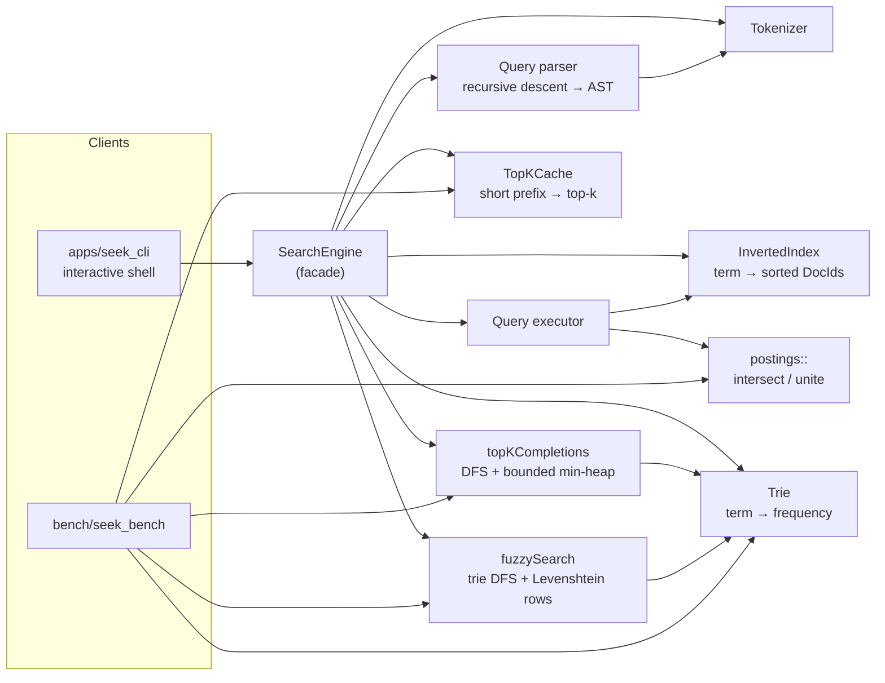

# seek

[](https://github.com/gusfring3369/seek/actions/workflows/ci.yml)


An in-memory full-text search engine in modern C++20 with three query paths:

- **Boolean search** over an **inverted index**. Supports `AND`, `OR` and parentheses, and picks between a two-pointer merge and **galloping search** for each intersection.
- **Top-k autocomplete** from a **prefix trie** and a **bounded min-heap**. A **top-k cache** answers short prefixes and is updated on every insert.
- **Typo-tolerant "did you mean?"** search. It runs **Levenshtein dynamic programming** row by row during a trie DFS and **prunes** subtrees that can't match.

```text
seek> distributed AND (storage OR database)
(distributed AND (storage OR database)) -> 2 document(s) (12.0 µs)
  [2] High performance distributed database built on a B+ tree storage engine
  [5] Distributed key value storage engine with a skip list memtable and write ahead log
seek> consensus algoritms
(consensus AND algoritms) -> 0 document(s) (1.2 µs)
  'algoritms' is not indexed. Did you mean 'algorithms'?
seek> :complete d
5 completion(s) for 'd' (0.4 µs)
  distributed              freq 5
  database                 freq 4
  ...
```

## Highlights

Measured on a 370,105-word English dictionary ([benchmarks](#benchmarks)):

| | Result |
|---|---|
| Autocomplete, 1–3 character prefixes | **p99 ≤ 2.2 µs** with the top-k cache, compared with up to 4 ms for a plain trie walk |
| Autocomplete, any prefix length | **p99 ≤ 0.22 ms** |
| Fuzzy search, 1 edit | **0.23 ms mean, 215× faster** than running the DP against every word. Computes **0.06%** of the DP cells. |
| Fuzzy search, 2 edits | 2.5 ms mean, 20× faster. Visits **1.7%** of trie nodes. |
| `AND` on posting lists of 91 and 1M ids | **7 µs** with galloping, compared with 678 µs for the two-pointer merge |
| Correctness | 54 tests, including randomized property tests against brute-force reference implementations. Runs clean under ASan/UBSan. Builds with `-Werror` on GCC and Clang. |

## Quick start

Requirements: a C++20 compiler (GCC ≥ 13 or Clang ≥ 17 for `<format>`) and CMake ≥ 3.20. GoogleTest is used if it is installed and downloaded automatically otherwise.

```bash
cmake -S . -B build
cmake --build build -j
./build/seek data/sample_corpus.txt          # interactive shell, one document per line
ctest --test-dir build --output-on-failure   # unit + property + CLI tests
```

Shell commands:

| Input | Action |
|---|---|
| `distributed AND (storage OR database)` | Boolean search. `AND` binds tighter than `OR`, and adjacent words are ANDed. |
| `:complete <prefix>` / `:c` | Top-5 completions by corpus frequency |
| `:fix <word>` / `:f` | "Did you mean" suggestions within 2 edits |
| `:stats`, `:help`, `:quit` | — |

The library can also be used directly:

```cpp
#include "seek/search_engine.hpp"

seek::SearchEngine engine;
engine.addDocument("Distributed key value storage engine with a skip list");
engine.addDocument("High performance distributed database with a B+ tree index");

std::vector<seek::DocId> hits = engine.search("distributed AND (storage OR database)");
auto completions = engine.autocomplete("dat", 5);   // [{"database", 1}]
auto corrections = engine.didYouMean("databse");     // [{"database", 1 edit, 1}]
```

## Architecture



**Indexing.** `addDocument(text)` tokenizes the text once. The terms go to the `InvertedIndex`, which assigns the next `DocId`, and to the vocabulary `Trie`, which adds 1 to each term's frequency. The trie returns the new frequency, and the `TopKCache` uses it to update the term's short prefixes.

**Querying.**

| Request | Path |
|---|---|
| `search(q)` | `parseQuery` → `Query` AST → `execute` against the index → sorted `DocId`s |
| `autocomplete(p, k)` | `TopKCache::lookup` if `p` is short, otherwise `topKCompletions` over the trie |
| `didYouMean(w)` | `fuzzySearch` over the trie, sorted by distance, then frequency |

### Modules

| Header | Responsibility |
|---|---|
| [`types.hpp`](include/seek/types.hpp) | `DocId`, `PostingList` (strictly increasing ids), `Weight` |
| [`tokenizer.hpp`](include/seek/tokenizer.hpp) | Text → lowercase alphanumeric terms. Shared by documents and queries, so both are normalized the same way. |
| [`trie.hpp`](include/seek/trie.hpp) | Weighted prefix tree. Owns the data and exposes a read-only node view. |
| [`autocomplete.hpp`](include/seek/autocomplete.hpp) | `topKCompletions`: prefix walk plus a bounded min-heap over the subtree |
| [`top_k_cache.hpp`](include/seek/top_k_cache.hpp) | Precomputed top-k lists for short prefixes, updated on each insert |
| [`fuzzy.hpp`](include/seek/fuzzy.hpp) | `fuzzySearch`: trie DFS that carries one Levenshtein row per node and prunes subtrees |
| [`inverted_index.hpp`](include/seek/inverted_index.hpp) | Term → posting list. Assigns document ids. |
| [`posting_list.hpp`](include/seek/posting_list.hpp) | Two-pointer intersect/union, galloping intersect, adaptive `intersect` |
| [`query.hpp`](include/seek/query.hpp) | Query AST, recursive-descent parser, executor |
| [`search_engine.hpp`](include/seek/search_engine.hpp) | Facade that composes everything above. It is the only API the CLI uses. |

### Design decisions

1. **The index assigns document ids, so posting lists are sorted by construction.** A new document always gets the largest id so far, so indexing it is a `push_back` on each of its terms' lists, with no sorting or binary insertion. The posting-list algorithms depend on this invariant. A deduplication check against `back()` is enough because a repeated term can only collide with the last element.

2. **Data structures are kept separate from the algorithms that use them.** `Trie` only stores data. Autocomplete and fuzzy matching are free functions over its read-only `Node` view. Each can be tested on its own, and new strategies (the cache, a different ranking) can be added without touching the trie.

3. **Trie nodes don't store words.** A traversal rebuilds each word from its DFS path in one reused buffer. Memory then grows with the number of distinct prefixes, not total word length. The heap copies a word only when it actually enters the top-k.

4. **The top-k cache is updated exactly on every insert.** Short prefixes are the expensive case: `"s"` covers a large share of the vocabulary. They are also the most common case, because every query starts as a short prefix. `TopKCache` stores the best k words for every prefix of up to 3 characters (5,386 prefixes for 370k words). On each insert it updates the word's ≤ 4 prefixes in O(k). Frequencies only ever increase, so raising one word's weight can only move that word into or up a list. Updating it in place gives exactly the same answer as recomputing. A randomized test checks this against a full trie walk.

5. **Fuzzy matching shares DP rows across shared prefixes and prunes subtrees.** Running a full DP for each word costs O(|w|·|q|) per word. In this design, the DFS computes one row per trie node, so words that share a prefix share its rows. Row minima never decrease with depth, so once `min(row) > maxDistance` no descendant can match and the whole subtree is skipped. The rows are allocated once per depth and reused across siblings.

6. **Query execution avoids copying term posting lists.** A term's posting list is *borrowed* (a `std::span` into the index). Only the intermediate results of operators are owned. Copying a 1M-id list just to gallop through 91 ids of it would cost more than the intersection itself.

7. **`AND` operands are intersected smallest first.** Each intermediate result is bounded by the rarest term, and evaluation stops as soon as the result is empty. The parser flattens `a AND (b AND c)` into one n-ary node so that this ordering applies to all operands.

8. **The galloping threshold is measured.** `intersect()` switches to galloping search once the lists differ in size by ≥ 32×, the crossover measured by `seek_bench` (table below).

**Thread safety:** `const` methods are safe to call concurrently. `addDocument` needs exclusive access, so callers that mix reads and writes must add their own locking (single writer, many readers).

## Algorithms and complexity

L = query or prefix length, M = nodes in the prefix's subtree, k = number of results, V = trie nodes visited after pruning, P₁ ≤ P₂ = posting list lengths.

| Operation | Algorithm | Time | Extra space |
|---|---|---|---|
| Index a document | Tokenize, posting-list append, trie insert, cache update | O(len(t) + k) per term t | — |
| Autocomplete, prefix ≤ 3 characters | Hash lookup in the top-k cache | O(L + k) | — |
| Autocomplete, longer prefix | Trie walk + bounded min-heap | O(L + M log k) | O(k) |
| Did you mean | Trie-pruned Levenshtein DP | O(V · L) | O(depth · L) |
| `a AND b` | Two-pointer merge, or galloping when P₂ ≥ 32·P₁ | O(P₁ + P₂) or O(P₁ log(P₂/P₁)) | O(P₁) |
| `a OR b` | Two-pointer merge | O(P₁ + P₂) | O(P₁ + P₂) |
| Parse query | Recursive descent | O(query length) | O(AST size) |

## Benchmarks

`bench/seek_bench` prints these tables. Run on a 4-core Intel Xeon @ 2.10 GHz, GCC 13, `-O3` (Release), using the 370,105-word [dwyl/english-words](https://github.com/dwyl/english-words) list with Zipf-distributed popularity weights. Timings vary somewhat between runs. The ratios are stable.

```bash
./scripts/fetch_wordlist.sh                  # downloads data/words_alpha.txt (not committed)
./build/seek_bench data/words_alpha.txt      # or run without arguments for a synthetic vocabulary
```

Vocabulary: 370,105 words, 1,027,810 trie nodes, 5,386 cached prefixes. Built in 188 ms.

**Top-10 autocomplete latency by prefix length.** Prefixes longer than 3 characters fall back to the trie walk.

| prefix length | trie walk p50 (µs) | trie walk p99 (µs) | with top-k cache p50 (µs) | with top-k cache p99 (µs) |
|---:|---:|---:|---:|---:|
| 1 | 1912.3 | 4001.5 | 0.1 | 1.5 |
| 2 | 311.7 | 1746.0 | 0.2 | 2.1 |
| 3 | 44.4 | 560.8 | 0.4 | 2.2 |
| 4 | 12.5 | 226.3 | 12.4 | 213.4 |
| 5 | 6.4 | 115.8 | 6.3 | 110.7 |

**Fuzzy search, one random typo per query.** The baseline runs the full DP against every word and takes 48,231 µs per query.

| max edits | mean (µs) | p99 (µs) | speedup vs baseline | trie nodes visited | DP cells vs baseline |
|---:|---:|---:|---:|---:|---:|
| 1 | 225 | 476 | 215× | 0.20% | 0.059% |
| 2 | 2451 | 5136 | 20× | 1.74% | 0.511% |

**`AND` intersection against a 999,462-id posting list.** Median of 15 runs.

| short list | size ratio | two-pointer (µs) | galloping (µs) | faster |
|---:|---:|---:|---:|:---|
| 249,335 | 4× | 4190 | 5523 | two-pointer |
| 50,266 | 20× | 1204 | 1542 | two-pointer |
| 29,834 | 34× | 945 | 1089 | about even |
| 19,971 | 50× | 962 | 906 | galloping |
| 9,982 | 100× | 899 | 600 | galloping |
| 1,021 | 979× | 725 | 129 | galloping |
| 91 | 10,983× | 678 | 7 | galloping |

## Testing

```bash
ctest --test-dir build --output-on-failure
```

- **Unit tests** (GoogleTest) for each module, including edge cases: empty input, unknown terms, malformed queries, ties, and k = 0.
- **Property tests** compare each optimized algorithm with a simple reference on randomized inputs:
  - `fuzzySearch` against the full-matrix Levenshtein DP for every word
  - `topKCompletions` against collecting, sorting and truncating every match
  - `TopKCache` against a trie walk after thousands of weight increments
  - every intersection and union strategy against `std::set_intersection` / `std::set_union`
- **CLI smoke test** runs a scripted shell session over the sample corpus.
- **CI** (GitHub Actions) runs GCC and Clang Release builds with `-Werror`, a GCC Debug build with AddressSanitizer and UndefinedBehaviorSanitizer, and a `clang-format` check.

## Project layout

```text
include/seek/   public headers (one per component)
src/            implementations
apps/           seek_cli.cpp: interactive shell
bench/          seek_bench.cpp: reproducible benchmarks
tests/          GoogleTest unit + property tests
data/           sample_corpus.txt (40 short systems-engineering documents)
scripts/        fetch_wordlist.sh: benchmark dictionary download
```

## Limitations and next steps

- **No relevance ranking yet.** Boolean results come back in document-id order. The next step is BM25, which would mean storing term frequencies in postings and adding a top-k heap over scored documents.
- **Insert only.** There are no deletes or updates. The cache stays exact only because weights only grow, so deletes would need tombstones and periodic rebuilds, or lists kept with slack beyond k.
- **ASCII tokenizer.** There is no Unicode segmentation, stemming or stop-word handling.
- **Memory.** The index is memory-only. Possible improvements: a radix tree (compressing single-child chains), delta + varint compressed posting lists, and snapshot persistence to disk.
- **Concurrency.** Single writer. Copy-on-write snapshots would let readers run while documents are being indexed.
